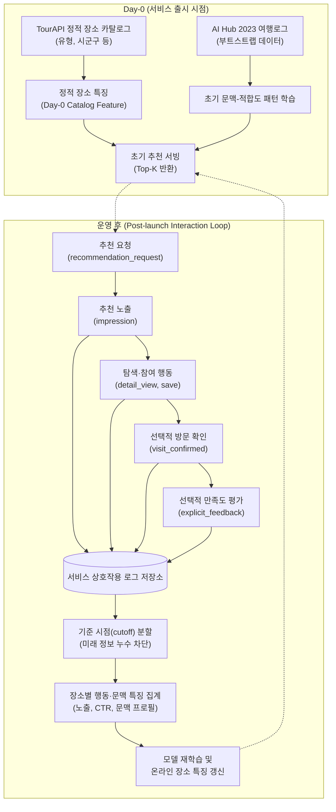

# 추천 서비스 상호작용 로그 계약

> AI Hub 여행로그는 서비스 출시 전 초기 학습·부트스트랩(bootstrap) 데이터이며, 실제 서비스가 운영되기 시작하면 서비스 자체 상호작용 로그(노출·클릭·저장·선택적 방문 확인·선택적 피드백)가 장소별 행동 특징을 점차 보완하거나 대체한다.

이 문서는 Travel Recommendation 서비스에서 발생하는 추천 요청과 사용자의 반응을 어떤 원칙과 구조로 기록할지 정의하는 상호작용 로그 계약이다. 오프라인 학습 데이터의 한계를 보완하고, 운영 이후에도 추천 모델과 장소 특징을 데이터 누수 없이 재현·갱신할 수 있는 최소한의 수집 기준을 제시한다.

## 질문과 현재 상태

### 1. 이 문서가 답하려는 질문
실제 서비스에서 어떤 추천 요청 문맥과 사용자 반응(노출, 클릭·상세 조회, 저장, 선택적 방문 확인, 선택적 만족도 피드백)을 최소한으로 기록해야 초기 AI Hub 학습 이후에도 장소별 특징과 방문자 문맥 프로필을 누수 없이 재현·갱신할 수 있는가?

### 2. 현재 상태
서비스 상호작용 로그의 수집 범위, 의미 경계 및 공통 필드 책임을 정의한 **설계 계약 단계**다. 실제 이벤트 데이터베이스(DB) 테이블/물리 스키마, 수집 API 엔드포인트, 보존 기간 및 법적 동의 절차는 백엔드 구현 단계에서 확정한다.

### 3. 한눈에 보는 결론
- **Day-0과 운영 후의 분리**: 서비스 시작 시점(Day-0)에는 TourAPI 카탈로그의 정적 장소 특징과 AI Hub 데이터로 학습한 초기 문맥-장소 적합도 패턴을 바탕으로 추천을 제공한다. 서비스가 운영되기 시작하면 자체 상호작용 로그를 바탕으로 장소별 행동·문맥 통계를 점진적으로 보완·갱신한다.
- **5단계 상호작용 신호 분리**: 추천 요청(`recommendation_request`), 추천 노출(`impression`), 탐색·참여 반응(`detail_view`/`click`, `save`/`bookmark`, 제품 기능에 포함될 경우 `itinerary_add`), 선택적 방문 확인(`visit_confirmed`), 선택적 명시적 피드백(`explicit_feedback`)의 다섯 단계 신호를 독립적으로 정의한다.
- **미노출과 미선택의 구분**: 노출 로그를 수집함으로써 **"애초에 보여주지 않음(미노출 = 알 수 없음, unknown)"**과 **"보여줬지만 선택하지 않음(관측된 비반응, observed non-engagement)"**을 명확히 구분한다. 단, 노출 후 미선택도 화면 표시 순위(rank), 뷰포트 배치, 함께 노출된 경쟁 후보의 영향을 받으므로 곧바로 "싫어함(절대적 음성, dislike)"으로 단정하지 않는다.
- **개인정보 최소 수집 원칙**: 백그라운드 GPS 위치 자동 추적이나 비정형 원시 자유 텍스트(`raw free text`) 수집을 기본 요구사항으로 두지 않는다. 실제 방문 여부는 여행 종료 후 사용자의 자발적이고 명시적인 확인 방식을 기본으로 둔다.

### 4. 현재 결정된 것
- 서비스가 수집해야 할 최소 신호 5종(`recommendation_request`, `impression`, `detail_view`/`save`, 선택적 `visit_confirmed`, 선택적 `explicit_feedback`)의 책임과 의미 경계를 확정했다.
- 추천 노출(`impression`)을 기록할 때 추천 요청 참조자, 후보 장소 식별자(`(tourapi-korservice2, contentid)`), 화면 표시 순위(`displayed_rank`), 모델·설정 버전(`model_config_version`), 노출 시각(`displayed_at`)을 반드시 함께 연결하기로 결정했다.
- 미노출(`unknown`)과 노출 후 미선택(`observed non-engagement`)을 분리하고, 온라인 클릭 수(`click_count`)나 저장 수(`save_count`)를 오프라인 관측 방문 수(`observed visit count`)와 같은 컬럼이나 의미로 조용히 덮어쓰지 않는 원칙을 확정했다.
- 장소별 비율·평균 지표를 집계할 때 지원 건수(`support count`, 분모)를 반드시 함께 보존하고, 분모가 0일 때는 `0%`가 아니라 결측(미관측 / 집계 대상 없음) 상태를 보존하기로 결정했다.
- GPS 상시 추적 및 원시 자유 텍스트 비저장 등 개인정보 최소 수집 경계를 수립했다.

### 5. 아직 결정되지 않은 것
- 방문자 문맥 프로필을 집계할 때 어떤 서비스 반응(예: `save`, `visit_confirmed` 등)을 기본 양성 상호작용(`positive interaction`) 기준으로 삼을지 확정하지 않았다.
- 초기 AI Hub 기반 장소 통계와 운영 후 서비스 상호작용 로그 기반 장소 통계를 어떤 가중치나 전환 조건으로 결합하거나 교체할지 확정하지 않았다.
- 선택적 명시적 피드백의 구체적인 UI 척도(만족/불만족 이진 평가 vs 추천의향 1~5점 척도)는 사용자 경험(UX) 설계와 함께 검토한다.
- 실제 이벤트 DB 테이블/물리 스키마, 파티셔닝, 데이터 보존 기간(retention), 회원 탈퇴 시 파기·비식별화 정책, 분석 동의(analytics consent) 세부 기준은 백엔드 및 정책 구현 단계에서 확정한다.

### 6. 다음 행동
추천 가능한 장소의 제품 범위(관광·문화·체험 외 식당·쇼핑·숙박 포함 여부)와 장소 표현 특징의 구별력 검증 결과를 확인한 뒤, 백엔드 API 및 이벤트 저장소 설계 시 본 계약의 최소 이벤트 공통 필드와 의미 경계를 반영한다.

---

## 필요한 용어

이 문서에서 사용하는 핵심 용어는 [추천 시스템 용어 사전](glossary.md) 및 [추천 문제 정의 v2](problem-definition-v2.md)의 기준을 따른다.

- **추천 노출(impression)**: 사용자의 화면 뷰포트에 실제로 표시되어, 사용자가 인지하고 선택할 기회가 주어졌던 추천 아이템 목록 또는 개별 장소의 표시 이벤트다.
- **관측된 비반응(observed non-engagement)**: 사용자에게 실제로 추천으로 노출되었으나 클릭, 저장, 상세 조회 등의 후속 상호작용이 관측되지 않은 상태다. 추천 기회 자체가 없었던 미노출(unknown)과 엄격히 구분되며, 위치 편향(position bias)의 영향을 받으므로 절대적 불호(dislike)와 동일시하지 않는다.
- **노출 대비 클릭률(click-through rate, CTR)**: 특정 장소가 추천 목록에 노출된 총 횟수 대비 상세 조회나 클릭으로 이어진 횟수의 비율이다. 분모인 총 노출 횟수(지원 건수)를 반드시 함께 관리해야 왜곡을 방지할 수 있다.
- **선택적 방문 확인(visit_confirmed)**: 여행이 끝난 후 사용자가 추천 장소에 실제로 다녀왔음을 서비스 화면에서 자발적·명시적으로 체크하거나 확인하는 선택적 행동 신호다.
- **명시적 피드백(explicit feedback)**: 별점, 추천 의향 점수, 만족/불만족 선택처럼 사용자가 장소에 대한 선호나 만족도를 직접 숫자나 평가 척도로 표현한 신호다.
- **학습-서빙 특성 호환성(training-serving feature parity)**: 오프라인 학습 데이터에서 정의하고 사용한 입력 특징을, 실제 온라인 서빙 및 통계 갱신 파이프라인에서도 동일한 의미와 계산 방식, 동일한 코드 체계로 일관되게 생성·공급할 수 있는 성질이다.
- **지원 건수(support count)**: 비율이나 평균 지표를 계산할 때 분모가 되는 유효 표본 수(노출 수, 클릭 수, 피드백 참여 수 등)다. 표본 수가 극히 적은 희소 장소(sparse POI)에서 평균값 왜곡을 방지하기 위해 필수적으로 동반된다.

---

## 1. Day-0(서비스 시작 시점)과 운영 후 특징 공급 구조

### 왜 AI Hub 통계만 영구 고정할 수 없는가?
AI Hub 국내 여행로그는 서비스 출시 전 초기 추천 모델을 학습시키고 여행 문맥과 장소 사이의 적합도 패턴을 파악하기에 매우 유용한 부트스트랩 데이터다. 그러나 다음 세 가지 근본적인 한계가 존재하므로 영구 고정 통계로 사용할 수 없다.

1. **시간적 고정성과 신규 장소 미반영**: AI Hub 데이터는 2023년 특정 시점에 수집된 오프라인 표본이다. 이후 새로 개장한 명소나 최신 여행 트렌드의 변화를 반영할 수 없다.
2. **카탈로그 연결의 제한성**: 다단계 식별자 연결 검증 결과, 지역 조건을 만족하는 서비스 카탈로그 19,051개 장소 중 AI Hub 방문 신호가 연결된 장소는 2,753개(14.45%)에 불과하다. 나머지 85.55%의 장소는 AI Hub 기반 행동 이력이 전혀 없는 콜드 스타트 상태다.
3. **분포 차이(Distribution Shift)**: 전문 설문 조사 패널이 기록한 여행로그와, 우리 서비스의 실제 사용자가 탐색하고 소비하는 행동 양식 사이에는 차이가 발생할 수밖에 없다.

따라서 서비스 시작 시점(Day-0)에는 정적 카탈로그 속성과 AI Hub 기반 초기 지식으로 추천을 시작하되, 서비스 운영이 시작되면 실제 사용자들의 서비스 상호작용 로그를 누적하여 장소 특징을 점진적으로 갱신해야 한다.

### 데이터 흐름 다이어그램

### Day-0과 운영 후의 특징 공급 비교

다음 표는 서비스 출시 시점(Day-0)과 운영 이후(Post-launch)에 추천 모델과 장소 특징이 어떤 데이터 원천으로부터 공급되는지 비교하여, 콜드 스타트 대응과 지속적 모델 개선의 차이를 판단하기 위한 자료다.

| 비교 항목 | Day-0 (서비스 출시 시점) | 운영 후 (Post-launch) |
| --- | --- | --- |
| **장소 특징 공급 원천** | TourAPI 정적 카탈로그 속성 (유형, 행정구역) + AI Hub 연결 장소의 초기 통계 | TourAPI 정적 카탈로그 속성 + 서비스 상호작용 로그 기반 롤업 집계 통계 |
| **추천 후보 자격** | 서비스 카탈로그 기준 적격 장소 전체 (AI Hub 미연결 장소 포함) | 서비스 카탈로그 기준 적격 장소 전체 + 운영 적합성 검증 장소 |
| **신규 장소(cold-item) 표현** | 행동 통계 결측 상태를 보존하고 정적 속성(유형, 지역)만으로 표현 | 정적 속성으로 시작한 뒤, 신규 노출·클릭이 누적되는 즉시 행동 특징 갱신 |
| **주요 상호작용 신호** | AI Hub 설문 기반 오프라인 관측 방문(`observed visit`) | 서비스 추천 요청 문맥, 노출(`impression`), 클릭, 저장, 선택적 방문 확인 |
| **신호 분리 원칙** | 미방문 장소의 노출 여부를 알 수 없음 (미노출 = unknown) | 노출(`impression`)을 명시 기록하여 미노출(unknown)과 미선택(non-engagement)을 엄격히 분리 |
| **특징 갱신 방식** | 오프라인 정적 파일 배포 | 배치 파이프라인을 통한 주기적 행동 집계 및 모델 재학습 |

### 절대 섞지 않는 데이터 경계 원칙
- **컬럼 혼용 금지**: 서비스에서 발생하는 온라인 클릭 수(`click_count`)나 저장 수(`save_count`)를 오프라인 AI Hub의 관측 방문 수(`observed visit count`)와 같은 컬럼이나 동일한 수치로 조용히 합치거나 덮어쓰지 않는다.
- **출처와 신호 유형의 분리 보존**: 장소 특징 테이블이나 분석 마트에서 데이터 출처(`aihub_bootstrap` vs `service_interaction`)와 상호작용 신호 유형(`click`, `save`, `confirmed_visit`)을 명확한 별도 필드로 보존한다.

---

## 2. 서비스에서 수집해야 하는 최소 신호

다음 표는 추천 품질 향상과 누수 없는 특징 재생성을 위해 서비스가 반드시 수집해야 할 5단계 핵심 신호의 정의와 수집 시점, 필수 식별자를 판단하기 위한 기준이다.

| 신호 단계 | 이벤트 유형 (`event_type`) | 발생 시점 | 주 수집 목적 | 필수 연결 식별자 |
| --- | --- | --- | --- | --- |
| **1단계: 요청 문맥** | `recommendation_request` | 사용자가 여행 조건을 입력하고 추천을 요청할 때 | 추천 당시의 여행 상황 및 취향 기록 (특징 생성 및 재현) | `request_id`, `user_id`(또는 비식별 세션 ID) |
| **2단계: 추천 노출** | `impression` | 추천 결과 목록이 사용자 화면 뷰포트에 렌더링될 때 | 사용자에게 노출된 후보 장소와 표시 순위 기록 (순위 편향 보정) | `request_id`, `catalog_poi_id`, `displayed_rank`, `model_config_version` |
| **3단계: 탐색·참여** | `detail_view` / `save` (`itinerary_add`) | 사용자가 추천 결과나 카탈로그에서 장소를 클릭하거나 북마크할 때 | 즉각적인 관심 및 선호 신호 포착 (CTR, 저장률 계산) | `catalog_poi_id`, `impression_id`(추천 경유 시 선택적 참조) |
| **4단계: 방문 확인** | `visit_confirmed` (선택적) | 여행 종료 후 사용자가 실제로 방문한 장소를 수동 확인할 때 | 실제 오프라인 방문 양성 신호 확보 (클릭·저장과의 격차 검증) | `user_id`, `catalog_poi_id`, `request_id`(연결 가능 시) |
| **5단계: 명시적 피드백** | `explicit_feedback` (선택적) | 방문 확인 후 사용자가 만족도나 추천의향을 평가할 때 | 장소별 품질 및 사용자 만족도 평가 (사후 평가 라벨 확보) | `catalog_poi_id`, `feedback_value`, `scale_type` |

### 2.1 추천 요청 문맥 (`recommendation_request`)
사용자가 추천을 요청하는 시점에 명시적으로 입력한 여행 조건을 기록한다. 이는 향후 오프라인 재학습 시 모델의 요청 문맥 특징으로 그대로 재현된다.

- **목적 지역 (`region` 및 구체적 시군구)**: 광역 시도 코드 및 사용자가 선택한 세부 행정구역.
- **여행 시점 / 시작 월 (`month`)**: 계획된 여행의 시작 월("01".."12") 또는 계절 구분. 정규화된 추천 요청 문맥에는 원시 일자(YYYY-MM-DD) 대신 월 단위를 사용한다.
- **여행 기간 (`elapsed_days`)**: 당일, 1박 2일 등 전체 여행 일수.
- **동반자 유형 및 인원 (`companion_status`, `companion_count`)**: 나홀로, 가족, 친구/연인 등 동반자 구성과 총 인원수.
- **사용자가 실제로 입력한 여행 목적/동기 (`travel_motive`)**: 휴식/힐링, 문화/역사 탐방, 체험/레저 등 사전에 정의된 정형화 코드.
- **사용자가 실제로 입력한 여행 스타일 (`travel_style`)**: 사용자가 설문·선택 UI에서 직접 입력한 정형화된 여행 스타일 응답 코드(오프라인 학습 문항 코드 체계와 호환되도록 정의된 선택값).
- **개인정보 경계**: 사용자의 실시간 GPS 좌표, 원시 자유 텍스트(자연어 질의 원문), 주민등록번호 등 민감정보나 불필요한 개인정보는 기본값으로 수집하지 않는다.

### 2.2 추천 노출 (`impression`)
추천 모델이 점수화하여 실제로 사용자 화면에 보여준 후보 장소와 그 순위를 정확히 기록한다.

- **기록 필수 구성 요소**:
  - `request_ref`: 어떤 추천 요청의 결과로 표시되었는지를 가리키는 요청 식별자.
  - `catalog_poi_id`: 화면에 노출된 장소의 카탈로그 표준 식별자(`(tourapi-korservice2, contentid)`).
  - `displayed_rank`: 화면에서 해당 장소가 몇 번째 순위(1, 2, 3...)로 렌더링되었는지 나타내는 정수 순위.
  - `model_config_version`: 해당 추천 결과를 생성한 추천 엔진의 모델명, 가중치 버전, 파라미터 식별자.
  - `displayed_at`: 화면에 실제로 노출된 UTC 타임스탬프.
- **PRD FR-4 추천 응답 계약과의 연결**:
  PRD의 FR-4(Recommendation)에서 정의한 추천 API 반환 규격(`itemId`, `rank`, `modelVersion`)은 이 노출 로그를 수집하기 위한 직접적인 토대다. 추천 서버가 응답한 `itemId`와 `rank`, `modelVersion`이 클라이언트에서 누락 없이 `impression` 이벤트로 기록되어야만, 오프라인 평가 시 "어떤 모델 버전이 어떤 순위로 노출시켰는가"를 완벽히 역추적할 수 있다.

### 2.3 탐색·참여 행동 로그 (`detail_view` / `click`, `save` / `bookmark`, 조건부 `itinerary_add`)
사용자가 추천 목록이나 서비스 내 카탈로그에서 장소에 관심을 보인 행동을 기록한다.

- **신호의 종류**:
  - `detail_view` (또는 `click`): 장소 카드나 항목을 눌러 상세 정보를 조회한 행동.
  - `save` (또는 `bookmark`): 마이페이지나 관심 목록에 장소를 북마크/저장한 행동.
  - `itinerary_add`: 제품에 여행 일정 생성 기능이 추가될 경우, 특정 일정 코스에 장소를 추가한 행동.
- **노출 참조 연결 원칙**:
  각 이벤트는 반드시 대상 장소 식별자(`catalog_poi_id`)를 가져야 하며, 추천 결과를 보고 발생한 행동인 경우 해당 `impression` 또는 `request_ref`를 선택적으로 참조할 수 있어야 한다. 이를 통해 **"추천 목록 노출을 통해 발생한 반응"**과 **"일반 카탈로그 검색/둘러보기를 통해 발생한 자발적 반응"**을 분리하여 추천 모델의 순수 기여도(lift)를 측정할 수 있다.

### 2.4 선택적 방문 확인 (`visit_confirmed` — optional)
여행이 끝난 후 사용자가 실제로 장소를 방문했는지 확인하는 신호다.

- **원칙**: MVP의 기본 방식은 GPS 백그라운드 자동 추적이 아니다. 여행 종료 후 마이페이지나 여행 기록 관리 화면에서 사용자가 **"실제로 방문한 장소"를 체크하는 가장 단순하고 명시적인 수동 확인 방식**을 채택한다.
- **분리 이유**: 백그라운드 GPS 위치 추적은 배터리 소모, 사용자 반감, 까다로운 위치정보법 동의 등 운영 비용이 매우 크다. 또한 온라인에서의 상세 조회(`detail_view`)나 저장(`save`)은 단순한 '관심'일 뿐 '실제 방문'과 동일하지 않으므로, 방문 확인 신호를 별도의 독립된 상호작용으로 격리한다.

### 2.5 선택적 명시적 피드백 (`explicit_feedback` — optional)
장소를 방문한 사용자가 남긴 주관적인 평가 신호다.

- **방문 확인과의 분리**: 장소를 방문했다고 해서(`visit_confirmed = true`) 반드시 해당 장소에 만족했다는 뜻은 아니다. 따라서 방문 확인과 사후 만족도 평가는 별개의 이벤트로 분리한다.
- **가벼운 피드백 우선 원칙**: 서비스의 사용자 경험(UX)이 허용할 때, 가장 부담이 적은 단일 척도(예: 만족/불만족 이진 선택, 또는 추천 의향 1~5점 척도 중 하나)부터 수집을 시작한다.
- **AI Hub 다중 평가 항목 강제 금지**: AI Hub 오프라인 데이터처럼 전반적 만족도(`DGSTFN`), 재방문 의향(`REVISIT_INTENTION`), 타인 추천 의향(`RCMDTN_INTENTION`) 3종을 모든 사용자에게 의무적으로 요구하는 것을 서비스의 기본값으로 두지 않는다. 과도한 입력 요구는 서비스 이탈을 초래하므로 지양한다.

---

## 3. 노출과 미선택의 의미 경계 (AI Hub vs 서비스 로그)

다음 표는 AI Hub 오프라인 학습 데이터와 실제 서비스 운영 로그에서 사용자의 행동 관측 여부에 따라 해석할 수 있는 의미 경계를 비교하여, 모델 학습 시 음성 라벨(negative) 취급의 타당성을 판단하기 위한 기준이다.

| 상태 구분 | AI Hub 오프라인 데이터 해석 | 서비스 운영 로그 해석 | 추천 모델 학습 시 취급 원칙 |
| --- | --- | --- | --- |
| **추천에 미노출된 장소** | **알 수 없음 (unknown)** 설문 특성상 사용자에게 노출되었는지 기록 자체가 존재하지 않음 | **알 수 없음 (unknown)** 추천 목록에 포함되지 않아 사용자가 볼 기회가 없었음 | 절대적 불호(dislike)로 취급 불가. 음성 표본 추출 시 비교용 후보(unobserved)로만 사용 |
| **노출되었으나 미선택된 장소** | **수집 불가 (해당 상태 없음)** 미방문 장소의 노출 이력을 추적할 수 없음 | **관측된 비반응 (observed non-engagement)** 화면에 표시되었으나 클릭/저장이 발생하지 않음 | 위치 편향(position bias)과 후보 경쟁을 고려하여 취급. 절대적 불호(hard negative)로 직결하지 않음 |
| **노출 후 탐색·선택된 장소** | **관측 방문 (observed positive)** 설문에 기록된 방문 장소 | **관측된 참여 (observed positive)** 상세 조회, 저장, 일정 추가 등 명시적 반응 발생 | 랭킹 학습의 단계별 암묵적 양성(implicit positive) 신호로 활용 |

### 관측된 비반응을 곧바로 "싫어함(불호)"으로 볼 수 없는 이유
서비스에서 특정 장소가 화면에 노출되었음에도 사용자가 클릭하지 않았다는 사실(`observed non-engagement`)을 "사용자가 그 장소를 싫어한다(dislike / hard negative)"고 단정해서는 안 된다. 여기에는 다음과 같은 외생적 요인이 강력하게 개입하기 때문이다.

1. **표시 순위 편향 (Position Bias)**: 대부분의 사용자는 화면 최상단(1~3위)에 있는 장소를 먼저 집중해서 살펴본다. 5위 이하, 특히 모바일 화면을 스크롤해야만 보이는 순위에 노출된 장소는 화면에는 렌더링되었더라도 사용자의 시선이 실제로 도달하지 않았을 가능성이 높다.
2. **뷰포트 및 디바이스 제약**: 모바일 환경에서는 한 화면에 1~2개의 장소 카드만 온전히 표시된다. 빠른 스크롤 과정에서 발생한 노출은 인지된 노출이 아닐 수 있다.
3. **후보 경쟁 (Candidate Competition)**: 함께 노출된 다른 후보 장소가 사용자의 당일 여행 목적에 완벽히 부합하여 선택되었을 뿐, 선택받지 못한 장소 자체가 매력 없거나 싫어서 배제된 것이 아니다.
4. **결론**: 따라서 노출 후 미선택은 "인지되었으나 후순위로 밀린 약한 신호"로 다루어야 하며, 순위 학습 시 위치 편향 보정(예: Inverse Propensity Scoring)이나 약한 음성 가중치로 다루어야지, 절대적인 거절이나 불호로 라벨링해서는 안 된다.

---

## 4. 서비스 로그에서 파생 가능한 장소(POI) 특징과 장소 표현 재현 연결

다음 표는 장소 표현 강화 작업(정적 카탈로그 속성, 과거 방문자 문맥 분포, 피드백 통계)의 각 계층이 실제 서비스 상호작용 로그에서 어떤 파생 특징으로 재현되는지 판단하기 위한 매핑 기준이다.

| 장소 표현 계층 | 서비스 로그 파생 특징 명칭 | 필요 최소 로그 신호 | 지원 건수(support count) 및 결측 처리 규칙 |
| --- | --- | --- | --- |
| **1. 노출·행동 집계** | `impression_count`, `click_count`, `save_count`, `ctr`, `save_rate` | `impression`, `detail_view`, `save` | 분모(`impression_count`) 필수 동반. 노출 0회인 장소는 `0%`가 아니라 `None`(미관측 결측)으로 보존 |
| **2. 반응자 문맥 프로필** | 여행 스타일별 반응 비율, 여행 동기별 반응 비율, 동반자 유형별 반응 비율, 계절별 반응 비율 | `recommendation_request` + 양성 반응(`save` 등) | 장소별 총 양성 반응 수(분모) 필수 동반. 반응 이력이 없는 장소는 카테고리별 `None` 결측 보존 |
| **3. 품질·피드백 집계** | `feedback_count`, `positive_feedback_rate`, `feedback_mean` | `explicit_feedback` | 피드백 참여 건수(`feedback_count`) 필수 동반. 피드백이 없는 장소는 기본값 `None` 보존 |

### 4.1 노출·행동 기반 집계
- **도출 지표**:
  - `impression_count`: 특정 장소가 추천 목록에 노출된 누적 횟수.
  - `click_count`: 해당 장소의 상세 조회가 발생한 누적 횟수.
  - `save_count`: 해당 장소를 저장/북마크한 누적 횟수.
  - `ctr` (Click-Through Rate): $\frac{\text{click\_count}}{\text{impression\_count}}$
  - `save_rate`: 기본 예시는 노출 대비 저장 비율($\frac{\text{save\_count}}{\text{impression\_count}}$)을 기준으로 하되, 분석 목적에 따라 클릭 대비 저장 비율($\frac{\text{save\_count}}{\text{click\_count}}$) 등 단계별 전환율로 정의할 수 있다.
  - `confirmed_visit_rate`: 방문 확인 기능 제공 시, 기본 예시는 노출 대비 확인 비율($\frac{\text{confirmed\_visit\_count}}{\text{impression\_count}}$)로 두되, 저장 대비 방문 비율($\frac{\text{confirmed\_visit\_count}}{\text{save\_count}}$) 등 깔때기(funnel) 단계별 전환율로 세분화할 수 있다.
- **지원 건수 및 결측 상태 보존 원칙**:
  - 비율 지표를 정의할 때는 **어떤 분모(`impression_count`, `click_count`, `save_count` 등)를 사용했는지 지표 이름과 버전에 명시하며, 분모 지원 건수(support count)를 항상 세트로 함께 보존**한다.
  - 분모가 0인 장소는 해당 비율을 `0.0`으로 대체하지 않고 `None` 또는 `NaN` 상태로 보존한다. **"한 번도 보여준 적이 없는 장소(미관측)"**와 **"100번 보여줬는데 한 번도 안 누른 장소(CTR 0%)"**는 완전히 다른 정보이기 때문이다.

### 4.2 방문자·반응자 문맥 프로필 기반 집계
오프라인 AI Hub에서 산출했던 "장소별 과거 방문자 문맥 분포(동반자 비율, 여행 스타일 비율 등)"를 서비스 운영 로그에서 동일한 논리 형태로 재현한다.

- **양성 상호작용의 명시적 정의 선행**: 문맥 프로필을 집계하기 전에 어떤 행동(예: `save` 이상, 또는 `visit_confirmed`)을 프로필 산출의 유효한 양성 상호작용(`positive interaction`)으로 간주할지 사전에 명확히 고정한다.
- **정규화된 요청 문맥 결합**: 양성 반응이 발생한 이벤트에 연결된 추천 요청 문맥(`recommendation_request`)의 정규화된 값을 조인하여 장소별로 집계한다:
  - **여행 스타일별 상호작용 비율**: 해당 장소를 선택한 사용자들의 여행 스타일 분포.
  - **여행 동기별 상호작용 비율**: 해당 장소를 선택한 사용자들의 여행 목적/동기 분포.
  - **동반자 유형별 상호작용 비율**: 가족 동반, 나홀로, 친구/연인 등의 구성 비율.
  - **여행 시작 월/계절별 상호작용 비율**: 봄, 여름, 가을, 겨울 등 방문 시기 분포.
- **오프라인 방문자 프로필과의 호환성**:
  이렇게 산출된 특징은 오프라인 AI Hub 기반 장소 방문자 프로필(`POI historical visitor profile`)과 완전히 동일한 논리 구조(지원 건수 + 문맥 카테고리별 정규화 비율 벡터)를 유지한다. 따라서 모델 재학습 시 학습-서빙 특성 호환성(`training-serving feature parity`)을 매끄럽게 유지할 수 있다.
- **미래 정보 누수(Data Leakage) 차단 규칙**:
  오프라인 모델 학습과 검증을 수행할 때, 특정 시점 $T$의 추천 요청에 대해 $T$ 이후에 발생한 서비스 로그로 계산된 장소 문맥 통계를 입력 특징으로 사용해서는 안 된다. 반드시 **기준 시점(cutoff) 이전(inner-train)의 상호작용 로그만으로 롤업 집계한 특징**을 결합해야 시계열 정보 누수를 방지할 수 있다.

### 4.3 피드백 기반 집계 (피드백 기능이 존재할 때만 적용)
- **도출 지표**: `feedback_count` (총 평가 수), `feedback_mean` (평균 만족도/추천의향 점수), `positive_feedback_rate` (만족 비율).
- **집계 원칙 및 누수 방지**:
  - 지원 건수(`feedback_count`) 없이 평균값만 단독으로 사용하지 않는다. 피드백이 단 1건 접수되어 5점을 기록한 장소를 수백 건의 피드백으로 평균 4.5점을 기록한 장소보다 우수한 장소로 판단하는 오류를 방지하기 위함이다. (표본이 적은 경우 베이지안 평활화나 신뢰 하한 적용 검토)
  - **사후 피드백 누수 차단**: 현재 추천을 요청한 사용자가 여행을 다녀온 뒤 남긴 피드백 점수는, 그 사용자에게 추천을 제공하던 요청 시점의 모델 입력으로 절대 들어갈 수 없다. 오직 다른 사용자들이 남긴 '과거 누적 집계치'만이 장소의 사전 품질 특징으로 사용될 수 있다.

---

## 5. 최소 이벤트 공통 필드 계약

다음 표는 향후 백엔드 이벤트 수집 API 및 이벤트 스토리지 테이블을 설계할 때 추천 파이프라인과의 정합성을 보장하기 위해 반드시 갖추어야 할 최소 공통 필드의 책임과 역할을 판단하기 위한 기준이다.

| 공통 필드명 | 데이터 타입 | 필수 여부 | 필드 책임 및 의미 |
| --- | --- | --- | --- |
| `internal_event_id` | String (UUID / CUID) | 필수 | 이벤트 고유 식별자. 클라이언트 재전송이나 네트워크 재시도 시 중복 적재 방지(idempotency key) |
| `event_type` | String (Enum) | 필수 | 이벤트 유형 구분자 (`recommendation_request`, `impression`, `detail_view`, `save`, `visit_confirmed`, `explicit_feedback`) |
| `event_timestamp` | String (ISO 8601 UTC) | 필수 | 이벤트 발생 시각. 시계열 순서 보장 및 누수 방지용 cutoff 분할의 기준 |
| `internal_user_session_request_ref` | String | 필수 | 추천 요청 및 사용자 세션을 추적하는 비식별 식별자. 문맥 특징과 상호작용 이벤트를 연결하는 조인 키 |
| `catalog_poi_id` | String | 조건부 필수 | 장소 식별자. TourAPI 표준 체계인 `(tourapi-korservice2, contentid)` 형식 (`recommendation_request`를 제외한 모든 장소 관련 이벤트 필수) |
| `recommendation_rank` | Integer | 조건부 | 추천 결과 목록 내 노출 순위 (1부터 시작하는 정수). `impression`, 추천 경유 `detail_view`/`save` 시 필수, 일반 카탈로그 탐색 시 null |
| `model_config_version` | String | 조건부 | 추천 결과를 산출한 모델 및 가중치/설정 버전 식별자 (PRD FR-4 modelVersion). 노출 이벤트 및 추천 경유 상호작용 시 필수 |
| `normalized_request_context_version` | String | 필수 | 요청 당시 입력된 여행 문맥의 정규화 스키마 버전. 문맥 정의 변경 시 호환성 추적용 |

### 물리 구현과의 경계
정확한 데이터베이스 기술(PostgreSQL 파티션 테이블, ClickHouse, DynamoDB 등), 물리적 인덱싱 전략, 압축 포맷(Parquet) 및 배치 집계 롤업 주기는 백엔드 아키텍처 및 데이터 엔지니어링 구현 이슈에서 최종 확정한다. 본 계약은 데이터의 의미론적 무결성과 추천 모델 서빙 호환성을 위한 최소 논리 인터페이스를 규정한다.

---

## 6. 개인정보·제품 경계와 제외 범위(Non-Goals)

### 기본 개인정보·제품 경계
1. **GPS 실시간 위치 자동 추적 배제**: 백그라운드 GPS 위치 추적은 배터리 소모와 불필요한 위치 정보 수집을 유발하므로 수행하지 않는다.
2. **원시 자유 텍스트(raw free text) 비저장**: 사용자가 입력하는 여행 목적이나 스타일은 사전 정의된 정형화 코드/옵션으로 수집하며, 비정형 자유 텍스트 내 개인 식별 정보나 민감정보가 이벤트 로그에 평문 저장되는 위험을 원천 차단한다.
3. **추천 목적에 필요한 최소 문맥만 수집**: 여행 지역, 시기, 기간, 동반자 구성, 정형 취향 외에 불필요한 인구통계 정보(성별, 연령대, 주민등록번호, 연락처 등)는 상호작용 로그에 포함하지 않는다.
4. **정밀 좌표 대신 행정구역 코드 활용**: 사용자의 현재 위치를 세부 GPS 위경도로 수집하지 않으며, 목적지 선택 시 법정동/시군구 수준의 행정구역 코드로 일반화하여 기록한다.
5. **목적 외 데이터 프로파일링 금지**: 수집된 상호작용 로그는 추천 품질 개선, 장소 행동 특징 갱신, 오프라인 모델 평가 목적 이외의 용도로 프로파일링하거나 외부에 제공하지 않는다.

### 백엔드 구현 전 별도 검토 항목
- **데이터 보존 기간 (Retention Policy)**: 원시 이벤트 로그의 보존 기한(예: 6개월~1년)을 설정하고, 보존 기한이 지난 원시 로그는 장소별 집계 수치로 롤업한 후 안전하게 파기하거나 비식별화하는 정책을 수립해야 한다.
- **회원 탈퇴 시 처리**: 사용자 탈퇴 시 해당 사용자의 세션 식별자와 연결된 로그를 삭제하거나 완전 비식별화(익명화) 처리하는 방안을 구현해야 한다.
- **분석 동의 획득 (Analytics Consent)**: 서비스 이용약관 및 개인정보 처리방침에 추천 서비스 개선 및 통계 분석을 위한 상호작용 로깅 동의 절차를 적법하게 마련해야 한다.

### 이번 설계에서 의도적으로 제외하는 범위 (Non-Goals)
- 실제 이벤트 DB 물리 테이블 DDL 작성 및 마이그레이션 스크립트 작성
- Kafka, RabbitMQ, Redis Streams 등 메시지 큐/스트리밍 브로커 기술 선정
- Feast 등 전용 Feature Store 인프라의 도입 및 구축
- 실시간 온라인 러닝(online streaming model update) 파이프라인 구축
- 백그라운드 GPS 위치 기반 자동 방문 판정 로직 개발
- 온라인 A/B 테스트용 무작위 트래픽 분할 및 통계 검정 플랫폼 구축
- 모델 재학습 크론 주기 및 오케스트레이션(Airflow 등) 파이프라인 완성

---

## 7. 확인된 사실, 해석, 결정, 미결정 구분

### 확인된 사실
- AI Hub 2023 여행로그의 전체 방문 관측 97,640건 중 TourAPI 장소와 연결된 건수는 26,454건(27.09%)이며, 지역 조건을 만족한 서비스 카탈로그 장소 19,051개 중 AI Hub 방문 신호가 연결된 장소는 2,753개(14.45%)다.
- AI Hub 원본 데이터에는 사용자에게 추천 장소가 화면에 노출되었는지 여부를 나타내는 노출 로그(`impression`)가 존재하지 않는다.
- PRD FR-4에서 추천 응답 규격으로 `itemId`, `rank`, `modelVersion`을 이미 확정하였다.
- 장소 카탈로그의 약 85.55%는 과거 방문 이력이 없는 콜드 스타트 상태이며, 이들 장소도 정적 속성(유형, 지역)만으로 추천 후보 표현이 가능해야 한다.

### 해석
- AI Hub 오프라인 데이터만으로는 시간 흐름에 따른 장소 인기도 변화나 신규 장소를 반영할 수 없으므로, 서비스 자체 상호작용 로그를 통한 점진적 특징 갱신이 필수적이다.
- 노출 후 미선택(`observed non-engagement`)은 사용자의 절대적 불호가 아니라 화면 표시 순위(position bias), 뷰포트 크기, 함께 노출된 타 후보와의 경쟁 결과로 해석해야 안전하다.
- 서비스의 온라인 클릭/저장 행동과 오프라인 실제 방문 행동은 행동의 심리적 비용과 의미가 완전히 다르므로, 같은 컬럼으로 통합 집계해서는 안 된다.

### 결정
- 상호작용 로그를 추천 요청(`recommendation_request`), 추천 노출(`impression`), 탐색·참여(`detail_view`/`save`), 선택적 방문 확인(`visit_confirmed`), 선택적 명시적 피드백(`explicit_feedback`)의 5단계로 분리 수집한다.
- 추천 노출(`impression`) 이벤트에는 요청 식별자, 카탈로그 장소 식별자(`(tourapi-korservice2, contentid)`), 노출 순위(`displayed_rank`), 모델 버전(`model_config_version`), 노출 시각(`displayed_at`)을 필수 결합한다.
- 미노출(`unknown`)과 노출 후 미선택(`observed non-engagement`)을 분리하고, 온라인 클릭/저장 수를 오프라인 방문 수와 분리하여 별도 필드로 보존한다.
- 비율 및 평균 특징 산출 시 지원 건수(`support count`, 분모)를 반드시 함께 관리하며, 분모 0일 때 `0.0`으로 대체하지 않고 결측(`None`) 상태를 보존한다.
- 모델 학습 및 평가 시 미래 정보 누수(data leakage)를 차단하기 위해, 특정 요청 시점 이전(cutoff)의 상호작용 로그만으로 장소 통계를 롤업 집계한다.
- 백그라운드 GPS 위치 자동 추적 및 원시 자유 텍스트 저장은 기본 수집 범위에서 제외한다.

### 미결정 / 추가 검증 필요
- 방문자 문맥 프로필 집계 시 어떤 서비스 상호작용(`save` 단독 vs `visit_confirmed` 결합)을 양성 상호작용의 기본 기준으로 고정할지 여부.
- Day-0 시점의 AI Hub 기반 장소 통계와 운영 후 서비스 로그 기반 장소 통계를 어떤 가중치나 전환 임계치로 블렌딩하거나 교체할지 여부.
- 선택적 명시적 피드백의 구체적 UI 척도(만족/불만족 이진 선택 vs 추천의향 1~5점 척도).
- 실제 이벤트 저장소 물리 스키마, 파티셔닝 전략, 데이터 보존 기간(retention) 및 회원 탈퇴 시 익명화/파기 기술 규격.

---

**근거·작업 이력(본문 이해에 필수 아님):** [#41](https://github.com/haeinChoe/Travel-Recommendation/issues/41), [#66](https://github.com/haeinChoe/Travel-Recommendation/issues/66), [#69](https://github.com/haeinChoe/Travel-Recommendation/issues/69), [#82](https://github.com/haeinChoe/Travel-Recommendation/issues/82), [#94](https://github.com/haeinChoe/Travel-Recommendation/issues/94), [#95](https://github.com/haeinChoe/Travel-Recommendation/issues/95), [#96](https://github.com/haeinChoe/Travel-Recommendation/issues/96), [#97](https://github.com/haeinChoe/Travel-Recommendation/issues/97), [#83](https://github.com/haeinChoe/Travel-Recommendation/issues/83).
